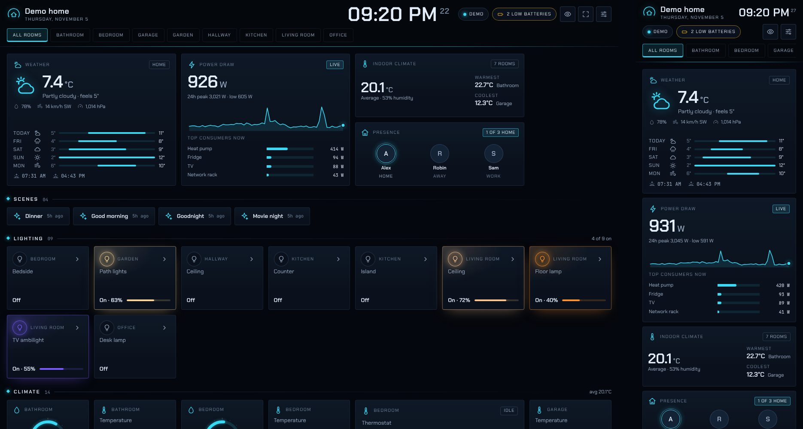

# Habitat: a tiled dashboard for Home Assistant

Habitat is a futuristic, tiled dashboard for Home Assistant that runs on Android and Linux. It finds
your entities on its own and lays them out as live tiles: gauges, meters, sparklines, weather, power
draw, presence, media, cameras and controls. Tap any tile for its history chart and every attribute.



It is plain HTML, CSS and JavaScript: no build step, no add-on, no custom integration and no external
JavaScript. Copy one folder into Home Assistant and open it.

## What it shows

| Section | Tiles |
|---|---|
| Overview | Weather with a 5-day range forecast and sunrise/sunset, power draw with a 24 h chart and the top consumers, indoor average with the warmest and coolest room, and who is home |
| Scenes | One-tap scene buttons |
| Lighting | Lights glow in their own colour, with a brightness meter. Tap to toggle, open for a dimmer |
| Climate | Thermostat rings with current and target temperature and −/+ steppers. Temperature tiles with sparklines and humidity gauges |
| Security | Doors, windows, motion, smoke, leak and other alarms (alarms turn the tile red), locks with a confirm-before-unlock step, and the alarm panel |
| Controls | Switches, fans, covers (open/stop/close), vacuums, water heaters, valves |
| Media | Now playing with artwork, progress and transport controls |
| Cameras | Snapshots refreshed every 10 seconds |
| Energy, Air & environment, Sensors | Every other numeric sensor as a value plus a 24 h sparkline. Text and timestamp sensors are shown as text |
| System | CPU, memory and disk gauges from System Monitor, and pending updates |
| Batteries | Every battery level as a segmented meter. Low ones are flagged and listed under *Needs attention* |

The header shows the clock, the connection state and a status pill. It reads *All clear*, *N low
batteries* or *N alerts*. Tap it to see what needs attention. Room tabs filter every section to one area.

The detail view has 6 H / 24 H / 3 D / 7 D ranges. Measurements are drawn as a line with a crosshair.
Meters like kWh are drawn as hourly or daily columns from long-term statistics. On/off devices get a
timeline. Every chart has a table view.

## Install

1. Copy this `dashboard` folder into your Home Assistant configuration as `www/habitat`, so that
   `index.html` ends up at `/config/www/habitat/index.html`. Use the Samba, File editor or Studio
   Code Server add-on, or `scp`. If `www` did not exist before, restart Home Assistant once.
2. Open `http://<your-home-assistant>:8123/local/habitat/index.html`.

To try it without Home Assistant, open `index.html?demo`. It runs on a simulated home with live
changing data. Opening `index.html` straight from disk also works for the demo.

## Android

**In the Home Assistant companion app (recommended).** In Home Assistant go to *Settings → Dashboards
→ Add dashboard → Webpage* and enter `/local/habitat/index.html`. Habitat now appears in the sidebar on
every device. Inside Home Assistant it reuses the app's own session, so there is nothing to log in to.
To open the app straight into Habitat on one device, go to *Profile → Dashboard* there and pick Habitat.

**On a wall tablet.** Open the `/local/habitat/index.html` address in Chrome or a kiosk browser such as
Fully Kiosk Browser, and sign in once. In Chrome, *Add to Home screen* gives it its own icon.
*Keep the screen on* (the eye button) works over HTTPS. Over plain HTTP, use the kiosk browser's own
screen-on setting.

## Linux

Open the address in any browser. For a full-screen wall display or an app-style window, use the
launcher in `linux/`:

```bash
# Menu entry with a "full screen" action, for the current user (no root):
./linux/install.sh http://homeassistant.local:8123/local/habitat/index.html

# Same, and start full screen at every login (wall display):
./linux/install.sh http://homeassistant.local:8123/local/habitat/index.html --autostart

# Or run it directly:
./linux/habitat-kiosk.sh http://homeassistant.local:8123/local/habitat/index.html            # kiosk
./linux/habitat-kiosk.sh --window http://homeassistant.local:8123/local/habitat/index.html   # window
```

The launcher uses Chromium, Chrome, Brave or Edge in app mode with its own profile, so the sign-in
stays separate from your normal browsing. It falls back to Firefox's kiosk mode. Set `HABITAT_BROWSER`
to pick a browser. Set `HABITAT_NO_BLANK=1` to stop an X11 screen from blanking. Press `Alt+F4` to leave
kiosk mode.

## Signing in

Habitat picks the first of these that applies:

1. **Embedded in Home Assistant** (Webpage dashboard): uses the Home Assistant session it is shown in.
2. **Served from `/local/`** in a browser that is already logged in to Home Assistant: reuses that login.
3. **Sign in**: on the connect screen, leave the token empty and press *Connect*. You go to Home
   Assistant's own login page and come back signed in. Tokens refresh on their own.
4. **Long-lived access token**: for a different origin or a file on disk. Enter the Home Assistant
   address and a token, created under *Profile → Security → Long-lived access tokens*.

Credentials stay in that browser's local storage only. *Display settings → Sign out on this device*
removes them and revokes the token Habitat created. Files under `/local/` can be fetched without
logging in, so **never put a token in `habitat.config.json`**.

If Habitat runs on a different address than Home Assistant, sign-in option 3 needs that address in
Home Assistant's `http: cors_allowed_origins`. Option 4 works without it.

## Configuration

Habitat needs no configuration. To change shared defaults for every screen, copy
`habitat.config.example.json` to `habitat.config.json` next to `index.html` and edit it:

| Key | Meaning |
|---|---|
| `title` | Name in the header. Defaults to your Home Assistant location name |
| `accent` | Default accent colour as `#rrggbb`. Each screen can still pick its own in *Display settings* |
| `powerSensor` | Entity for the *Power draw* tile. Defaults to the sensor named like total, grid, house or consumption, or else the largest power reading |
| `weather` | Weather entity for the overview. Defaults to the first one |
| `historyHours` | Length of the tile sparklines, in hours (default 24) |
| `hideSections` | Sections to leave out: `pulse` (overview), `scenes`, `lighting`, `climate`, `security`, `controls`, `media`, `cameras`, `energy`, `atmosphere`, `sensors`, `system`, `batteries` |
| `exclude` | Entity ids or `*` patterns to leave out, such as `"sensor.*_signal_strength"` |
| `include` | Entity ids or patterns to show even if they would be hidden |

Entities you hid in Home Assistant, and diagnostic or configuration entities, get no tile. Battery
levels and updates are the exception: they still show. Room tabs come from Home Assistant areas, either
the entity's or its device's. *Display settings* also has a compact density and an option to show
unavailable devices. These are saved per screen.

## Updating

Copy the folder again. If a browser keeps the old version, reload it once. The files are versioned
with a `?v=` suffix in `index.html`.

## Requirements

- A recent Home Assistant release. Habitat was tested with 2026.2 and its demo integration. On older
  releases that lack a feature, such as the forecast service (2023.12) or long-term statistics, that part
  is skipped or falls back to raw history.
- A current Chromium-based browser, Firefox or Safari. This includes the Android System WebView used by
  the companion app.

## Files

```
index.html                  page shell
css/habitat.css             design tokens and all styles
js/util.js                  escaping, storage, number and time formatting
js/icons.js                 line icons and entity-to-icon mapping
js/ha.js                    WebSocket client, OAuth and token handling, backend selection
js/demo.js                  simulated home for ?demo, using the same message formats as Home Assistant
js/model.js                 entity classification, layout, home-wide summaries
js/charts.js                sparkline, gauge, meter, line, column and timeline charts
js/tiles.js                 tile renderers
js/detail.js                detail view with history, controls and attributes
js/app.js                   boot, state stream, rendering, header, settings, actions
linux/                      kiosk launcher and desktop installer
habitat.config.example.json optional shared settings
```

Habitat is separate from the Android app in this repository. It has no Gradle module and does not change
the app. It runs inside the app through Home Assistant's Webpage dashboards.
